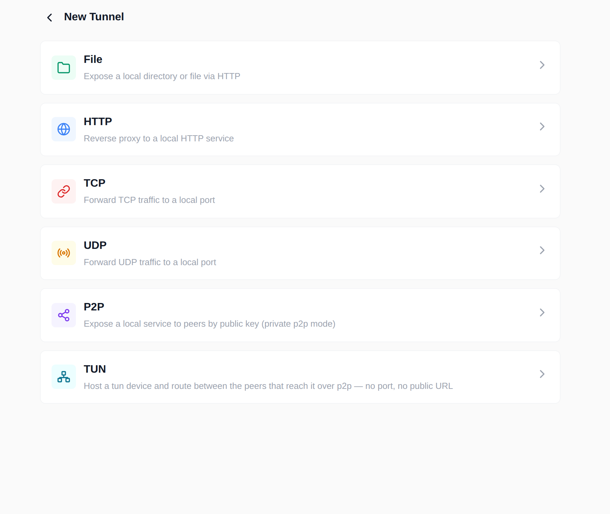
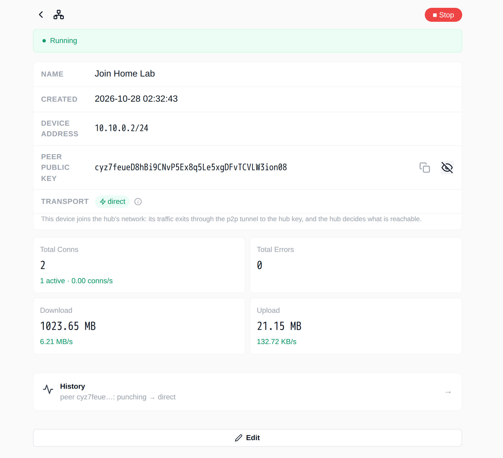

---
authors:
  - ginuerzh
categories:
  - Tutorial
readtime: 15
date: 2026-10-28
comments: true
---

# 用 wisper 组建私有 P2P 网络：按公钥穿透与 TUN 组网

wisper 不只是“把本地端口暴露到公网”的反向隧道管理器。它还有两种更私有的用法：

<!-- more -->

1. **P2P 隧道**：不开放任何公网端口、不分配公网 URL，只允许持有指定公钥的对端访问一个本地服务；
2. **TUN 组网**：让另一台机器加入一个虚拟网络，像在同一局域网里一样访问 hub 和它背后的网段。

这篇教程用三个角色（一个 hub、两个 spoke）从零走一遍。截图来自真实运行的 wisper 实例（English UI），命令和说明为中文。

## 读完你能做到什么

- 在一个 DERP 中继的帮助下，用公钥把本地服务安全地提供给另一台机器；
- 看懂 `direct` / `relay` 传输徽标，知道流量到底走哪条路；
- 创建一个 TUN hub，把 spoke 加入虚拟网络，并验证 `ping` 和 TCP 访问；
- 知道密钥、白名单、路由和权限的边界，遇到问题时能自己定位。

本文使用的实验拓扑：

| 角色 | 地址 | 作用 |
|---|---|---|
| DERP relay | `ws://derper:8080` | 信令 + 回退（实验环境自建；生产用 `wss://`） |
| hub | `10.10.0.1/24` | 持有 TUN 设备；P2P 隧道暴露 `127.0.0.1:8080` |
| laptop | `127.0.0.1:18080` | P2P 入口点，访问 hub 的服务 |
| tablet | `10.10.0.2/24` | TUN spoke，加入 hub 的虚拟网络 |

!!! note "为什么实验里有两个 spoke"
    P2P 入口点和 TUN 入口点都需要一个 p2p 身份（公钥）。在同一个 host 上，**一个公钥只能归属一条 p2p 隧道或一个 tun hub**——入站流按公钥路由，不能同时指向两个对象。所以实验里用 `laptop` 做 P2P 入口点、`tablet` 做 TUN spoke。实际使用时用两台设备即可，或者把 P2P 隧道建在另一个 hub 上。

## 准备工作

### 安装并启动

Docker 是最快的方式：

```bash
docker run -d --name wisper \
  -p 127.0.0.1:8900:8900 \
  -v wisper-data:/root/.config/wisper \
  gogost/wisper:latest
```

打开 `http://127.0.0.1:8900`。如果要做 TUN hub（或让 TUN spoke 创建设备），容器需要 `NET_ADMIN` 和 `/dev/net/tun`；要让对端访问 <strong>宿主机所在的局域网</strong>，还需要 host 网络：

```bash
docker run -d --name wisper \
  --network=host \
  --cap-add=NET_ADMIN \
  --device /dev/net/tun:/dev/net/tun \
  -v wisper-data:/root/.config/wisper \
  gogost/wisper:latest -addr 127.0.0.1:8900

# 只有需要 spoke 之间互通时才需要（Linux hub）
sudo sysctl -w net.ipv4.ip_forward=1
```

也可以从 [GitHub Releases](https://github.com/go-gost/wisper/releases) 下载对应平台的二进制（Linux/macOS/Windows/Android/Chrome），然后：

```bash
sudo ./wisper -addr 127.0.0.1:8900
```

!!! warning "wisper 的 Web UI/API 没有登录"
    `-addr` 默认监听 `:8900`（所有网卡）。请显式绑定 `127.0.0.1`，或把它放在带认证和 TLS 的反向代理后面。不要把 8900 直接暴露到公网——能打开页面的人就能创建隧道。

### 准备 DERP 中继

P2P 用一个 DERP 中继做信令和回退：能打洞时流量走直连，不能时回退到中继。

- **默认公共中继**：`wss://derp.gost.run/derp`，配置留空即使用它；
- **自建中继**：参考 [go-gost/derper](https://github.com/go-gost/derper) 的 `deploy/docker-compose.yml`，默认在 `:8443` 提供明文 WebSocket、在 `:3478` 提供 STUN；生产环境请用 TLS 反代成 `wss://`。

STUN 留空时，wisper 会推导“中继主机 + 3478”。如果中继不提供 STUN，wisper 会先探测再放弃打洞（不会卡住），流量继续走中继。

### 确认身份

在服务端和客户端分别打开 **Settings → P2P**：

1. 点眼睛图标显示 **P2P IDENTITY**，复制并妥善保存；
2. 填 DERP 地址，点 **Test**，看到 `Connected`；
3. 保持 **Direct (hole-punched) path** 开启；STUN 不是默认值时填上，点 **Test** 应显示公网地址；
4. 点 **Save**。


这个公钥就是本机的身份，可以发给对端用于拨号和白名单；真正的秘密是私钥文件 `p2p/host.key`，不要外泄。

!!! note "关于截图里的红色提示"
    设置页把身份 key 标成“密码”，是产品现有的保守文案。严格来说，<strong>公钥可以公开</strong>给要接入的对端；只有私钥（`p2p/host.key`）泄露才会让人冒充本机。白名单里的公钥决定谁能接入。

!!! note "截图中的中继地址"
    截图里的 `ws://derper:8080/derp` 是实验环境自建的明文中继；生产环境请用 `wss://`，并按需打开 **Verify relay certificate** 或填写 **Relay CA file**。

## 实战一：按公钥访问本地服务（P2P）

### 1. 在服务端创建 P2P 隧道

在 hub 上打开 **Tunnels → + → P2P**：



填写：

| 字段 | 示例 | 说明 |
|---|---|---|
| Name | `Private Service` | 仅用于展示 |
| Endpoint | `127.0.0.1:8080` | 本地要暴露的 TCP/UDP 服务地址 |

保存后隧道立即运行。P2P 隧道没有公网 URL，也没有监听端口——只有白名单里的公钥能拨进来。

### 2. 允许客户端公钥

打开这条隧道，进入 **Allowed peers**，点 **Add peer**，粘贴客户端 `laptop` 的公钥，别名填 `Laptop`，保存：


几个容易忽略的规则：

- **请求接入（pending）**：不在任何白名单里的公钥来敲门时，会出现在 peers 页的请求列表里。p2p 流本身不携带目的地，所以 wisper 不知道它想连哪条隧道；**Add to this tunnel** 才是把它加到当前这条。
- **禁用（disabled）**：公钥保留在列表里，但不再接入新连接；已建立的连接会自然结束。适合临时封禁而不是删除。
- **一个公钥只能属于一个对象**：在同一个 host 上，它要么属于一条 p2p 隧道，要么属于一个 tun hub。要把 peer 从一条隧道移到另一个，先从原处移除。
- **公钥即身份**：白名单是 p2p 唯一的应用层准入——只有在列表里的公钥能接入；p2p 不再做用户名/密码认证。公钥可以发给对端，私钥（`p2p/host.key`）不能。

### 3. 在客户端创建 P2P 入口点

在 `laptop` 上打开 **Entrypoints → + → P2P**：


截图里为了从宿主机访问绑定了 `0.0.0.0:18080`；日常使用建议绑定 `127.0.0.1:18080`，只让本机进程使用。

| 字段 | 示例 | 说明 |
|---|---|---|
| Name | `Private Service Entry` | 仅用于展示 |
| Bind Address | `127.0.0.1:18080` | 本地监听地址；填 `0.0.0.0` 会暴露给局域网 |
| Peer Public Key | hub 的 P2P IDENTITY | 拨号目标 |
| Protocol | `TCP` 或 `UDP` | 内层协议；按本地客户端需要选择 |

保存后，`laptop` 上访问 `127.0.0.1:18080` 的流量就会经 p2p 隧道到达 hub 的 `127.0.0.1:8080`。

### 4. 验证

```bash
curl -sS http://127.0.0.1:18080/healthz
```

预期输出：

```text
ok
```

打开这条入口点的详情页，应该能看到类似（数字随流量变化）：

```text
Running
Transport  direct  1ms
Total Conns  7
Download     12.00 MB
```

`direct` 表示两端已经打洞成功，流量不走中继；如果是 `relay`，隧道仍然可用，只是经过了中继。首页的隧道卡片和 peers 页会显示累计流量、当前连接数和实时速率：


### 5. UDP 与 keepalive

把入口点的 **Protocol** 改成 `UDP`，同一条 p2p 隧道就能服务 UDP 对端——隧道侧不需要改配置，它会透明地同时服务 TCP 和 UDP。

- **Keepalive 开（默认）**：在数据报之间保持客户端会话和隧道，适合持续的 UDP 应用；
- **Keepalive 关**：每个数据报建立一条隧道，语义正确但开销更大。

!!! note "P2P 入口点的 TCP 半关闭限制"
    当前实现不支持 TCP 半关闭：客户端调用 `shutdown(SHUT_WR)` 后，返回方向也会结束。`curl` 和浏览器不受影响；busybox `wget`、部分 `nc` 用法可能在发完请求后立刻半关闭，从而拿不到响应。验证时优先用 `curl`。

## 实战二：用 TUN 组建虚拟网络

### 角色和地址

TUN 模式和 P2P 隧道的区别在于：P2P 是“按公钥访问一个服务”，TUN 是“加入一张 IP 网络”。

| 角色 | 职责 | 需要权限 |
|---|---|---|
| **hub** | 持有 tun 设备，设备就是网络本身；负责在 peer 之间转发 | root / `CAP_NET_ADMIN` / 管理员 |
| **spoke** | 创建自己的 tun 设备，加入 hub 的网络 | root / `CAP_NET_ADMIN` / 管理员（Android 用 VpnService） |

- 地址由 hub 分配：hub 的 `net` 是 `10.10.0.1/24` 时，第一个 spoke 通常是 `10.10.0.2/24`；
- spoke 配置的地址必须和 hub peers 页分配给它的地址 <strong>完全一致</strong>；
- 典型拓扑是星形：所有流量经 hub 转发。spoke 之间互通需要 hub 开启 IP 转发。

### 1. 创建 hub

在 hub 上打开 **Tunnels → + → TUN**：


| 字段 | 示例 | 说明 |
|---|---|---|
| Name | `Home Lab` | 仅用于展示 |
| Device Address | `10.10.0.1/24` | hub 设备地址；这个网段就是虚拟网络 |
| MTU | `1420` | 默认值，通常不需要改 |
| Device Name | `wisper0` | 留空由内核命名 |
| Shared LAN | 留空 | 需要把 hub 侧局域网共享给 spoke 时再填 |

保存。hub 会创建一块 tun 设备并开始等待白名单里的 spoke。没有 peer 时它会提示“运行中，但不路由任何流量”。

### 2. 在 hub 上分配 spoke 地址

进入 **Allowed peers → Add peer**，粘贴 `tablet` 的公钥，别名 `Tablet`，<strong>IP 留空</strong>让 hub 自动分配，保存：


这里显示 `IP: 10.10.0.2`，把这个地址复制到 spoke 的配置里。几个细节：

- 行里的 IP 是 <strong>这个 spoke 可以声明的地址</strong>；spoke 声明的地址必须与它完全相等，否则 hub 不建路由、不回 keepalive，并在 hub 的事件里记一条 warn；
- <strong>清空</strong>一格表示“重新分配”；没动过的行不会改地址；
- 改 hub 的 `net` 时，如果已有地址不在新网段里，保存会被拒绝。要换网段，先在 peers 页移除 spoke，改完 `net` 再加回来；
- 在同一个 host 上，一个公钥只能属于一个 hub 或 p2p 隧道。

### 3. spoke 加入网络

在 `tablet` 上打开 **Entrypoints → + → TUN**，填写：

| 字段 | 示例 | 说明 |
|---|---|---|
| Name | `Join Home Lab` | 仅用于展示 |
| Device Address | `10.10.0.2/24` | <strong>必须</strong>是 hub 分配给它的地址 |
| MTU | `1420` | 与 hub 保持一致 |
| Peer Public Key | hub 的 P2P IDENTITY | 拨号目标 |
| Routes | 留空 | 留空 = 只路由 hub 的虚拟网段；也可填 `192.168.50.0/24` |
| DNS | 留空，或 hub 提供的 DNS 地址 | 可选；hub 不强制 |
| Shared LAN | 留空 | 需要把 spoke 侧局域网共享出去时再填 |

保存。spoke 会创建自己的 tun 设备，并通过 p2p 隧道拨到 hub。

!!! warning "关于 `0.0.0.0/0`"
    `0.0.0.0/0` 表示把全部流量送进 tun。桌面端要自行把 DERP 和打洞流量排除在 tun 之外（策略路由/排除中继地址），否则承载隧道的连接会绕回自己；Android 版当前不做全流量出口。教程只路由虚拟网段。

### 4. 验证

在 `tablet` 上：

```bash
ping -c 2 10.10.0.1
```

预期输出：

```text
PING 10.10.0.1 (10.10.0.1): 56 data bytes
64 bytes from 10.10.0.1: seq=0 ttl=64 time=0.500 ms
64 bytes from 10.10.0.1: seq=1 ttl=64 time=0.579 ms

--- 10.10.0.1 ping statistics ---
2 packets transmitted, 2 packets received, 0% packet loss
```

如果 hub 上有一个服务监听 `10.10.0.1:8080`（或 `0.0.0.0:8080`），再验证 TCP：

```bash
curl -sS http://10.10.0.1:8080/healthz
```

预期输出：

```text
ok
```




### 5. 共享局域网（可选）

TUN 默认只路由虚拟网段。如果想让 spoke 访问 hub 背后的真实局域网，或反过来，需要额外配置：

| 场景 | 配置 | 作用 |
|---|---|---|
| spoke 访问 hub 的局域网 | hub 的 **Shared LAN**，如 `192.168.1.0/24` | spoke 可以访问 hub 所在局域网 |
| hub / 其他 peer 访问 spoke 的局域网 | spoke 的 **Shared LAN**，如 `192.168.50.0/24`；同时 hub 的 peers 页给这个 spoke 填 **LAN allow** 行 | 由 hub 决定是否批准；不批准时 hub 会拒绝该声明并记事件 |

**Sharing Backend** 保持 `Auto`：优先内核 NAT（所有协议，包含 `ping`），内核不可用时降级到用户态 TCP/UDP。降级后 `ping` 到不了共享网段，但 TCP/UDP 仍然可用。

!!! tip "spoke 互通"
    两个 spoke 互相访问时，流量要在 hub 上转发。Linux hub 需要开启 `net.ipv4.ip_forward=1`，并允许防火墙转发；只访问 hub 自身时不需要。

### 6. Android 作为 spoke

Android 版通过系统的 `VpnService` 借用 tun 设备，不需要 root，但 <strong>只能当 spoke，不能当 hub</strong>：

- 首次启动会弹一次 VPN 授权；
- 设备地址同样要填 hub 分配的地址；
- 系统同一时间只允许一个 VPN；另一个 VPN 接管时，wisper 的 tun 入口点会停止而不是抢回来，重新启动即可；
- 当前版本不做全流量出口，只路由虚拟网段（以及你显式配置的网段）。

## 安全模型

- **公钥是身份，私钥是凭证**。公钥（P2P IDENTITY）用于拨号和白名单，可以分享；私钥在 `p2p/host.key`，泄露它才能冒充本机。白名单决定哪些身份能接入，强制加密握手会验证对方持有对应私钥。
- **数据面端到端加密**。当前版本的 p2p 数据面强制使用 X25519 临时密钥 + ChaCha20-Poly1305，TCP/UDP、直连/中继都加密；中继只转发密文，无法读取内容，也无法把连接降级成明文。中继仍能看到连接元数据（公钥、时间、流量大小）并可以选择拒绝服务。
- **内层协议本身仍是裸 TCP/UDP**。p2p 的加密保护的是 peer 之间的链路，不会替你的应用做 TLS。HTTP 服务仍应使用 HTTPS，或在应用层加认证。
- **Web UI/API 无认证**。只绑定 `127.0.0.1`，或放在带认证的反向代理后面。
- **轮换身份**：停止 wisper，删除配置目录下的 `p2p/host.key`，重启生成新 key，然后更新所有对端的白名单。
- **TUN hub 会接触宿主机网络**。共享 LAN 时尤其要审查白名单和防火墙规则。

!!! note "界面文案"
    如果你在入口点详情页看到“明文（内层协议不加密）”，那是 p2p 引入强制端到端加密之前的文案。当前版本以 **Settings → Diagnostics** 报告中的 `encryption is forced` 为准。

## 排错

### 传输徽标

| 徽标 | 含义 | 处理 |
|---|---|---|
| `direct` | 打洞成功，流量不经过中继 | 正常 |
| `relay` | 走中继，未使用直连 | 检查 UDP/STUN；对称 NAT 下属预期 |
| `punching` | 正在协商直连 | 等待 |
| `failed` | 该对端打洞失败（多为对称 NAT） | 会回退中继；检查网络 |
| `no-candidates` | 没有可用 STUN，也没有 IPv6 | 配置 STUN |
| `stun-unreachable` | 配了 STUN 但无响应 | 修正 STUN 地址/端口 |

把鼠标悬停在徽标上可以看到原因。首页卡片不显示徽标，因为一条隧道可能有多个对端、各走各的路；对端列表页和入口点详情页才有。

### 常见问题

| 现象 | 可能原因 | 处理 |
|---|---|---|
| Settings → P2P 的 Test 失败 | URL 写错、防火墙、`ws://`/`wss://` 不匹配、自签证书 | 核对 URL/端口和防火墙；自签中继可关闭证书校验或填 CA；内网调试可先用 `ws://` |
| 一直是 `relay` | 对称 NAT、UDP 被封、STUN 不可达 | 这是预期回退；检查 STUN Test |
| 客户端能连上但服务无响应 | Endpoint 写错、本地服务未监听、白名单没保存 | 在 hub 上先 `curl` 本地服务 |
| 入口点连不上 | 公钥复制错、key 已在另一个对象上、白名单未包含 | 核对 P2P IDENTITY 和 peers 页 |
| TUN `ping` 不通 | spoke 地址与 hub 分配不一致、hub 未运行、防火墙 | 对比 peers 页的 IP；看 hub 事件 |
| TUN TCP 通但 `ping` 共享网段不通 | Sharing Backend 降级到用户态 | 安装 iptables/给 `NET_ADMIN`，让内核 NAT 生效 |
| 创建 TUN 报权限错误 | 没有 root/CAP_NET_ADMIN，容器缺 `/dev/net/tun` | 按“准备工作”加权限 |

### 诊断报告与事件

**Settings → Diagnostics → Run diagnostic** 会输出一份可粘贴的报告：中继状态、传输计数、每个对端的路径和最近的打洞记录。对端列表页的 **History** 和 **Settings → Host events** 则记录断连、恢复和生命周期事件。先看这三处，通常比翻日志快。

## 用 API 自动化（可选）

所有 UI 操作都有对应的 HTTP API。比如在 hub 上创建 P2P 隧道并加白名单：

```bash
HUB=http://127.0.0.1:8900

# 创建 P2P 隧道，并记下返回的 id
TID=$(curl -s -X POST "$HUB/api/tunnels" \
  -H 'Content-Type: application/json' \
  -d '{"name":"Private Service","type":"p2p","endpoint":"127.0.0.1:8080"}' \
  | jq -r .id)

# 把客户端公钥加入白名单
curl -s -X PUT "$HUB/api/tunnels/$TID/peers" \
  -H 'Content-Type: application/json' \
  -d '{"peers":[{"key":"<laptop-key>","alias":"Laptop"}]}' \
  | jq '{name,status}'
# {"name":"Private Service","status":"running"}
```

在客户端创建入口点：

```bash
CLIENT=http://127.0.0.1:8900

curl -s -X POST "$CLIENT/api/entrypoints" \
  -H 'Content-Type: application/json' \
  -d '{"name":"Private Service Entry","type":"p2p","endpoint":"127.0.0.1:18080","peer":"<hub-key>","protocol":"tcp"}' \
  | jq '{name,type,status}'
# {"name":"Private Service Entry","type":"p2p","status":"running"}
```

TUN hub 的地址分配也可以通过 peers 接口完成：`ip` 留空时 hub 会从自己的 `net` 分配，响应里的 `options.peer_ips` 就是分配结果。完整路由见项目 README 的 REST API 表。

## 清理

- 在 UI 里停止或删除隧道/入口点；tun 设备会随对象关闭；
- 删除容器时同时删除数据卷（先 `docker rm` 再 `docker volume rm wisper-data`）会清掉配置和身份；
- 想换身份但保留配置：只删 `p2p/host.key`，重启后重新分发公钥。

P2P 负责“按公钥到达”，TUN 负责“按 IP 组网”。把两者分开理解，配置时就不会把白名单、路由和地址混在一起。祝组网顺利。

---

!!! note "关于本文的截图"
    截图来自一个隔离的 Docker 实验环境：本地 derper 中继 + 一个 hub + 两个 spoke（P2P/TUN 各一个）。地址、公钥和流量数字都是测试数据；实际部署请替换成你的中继域名、网段和密钥。
