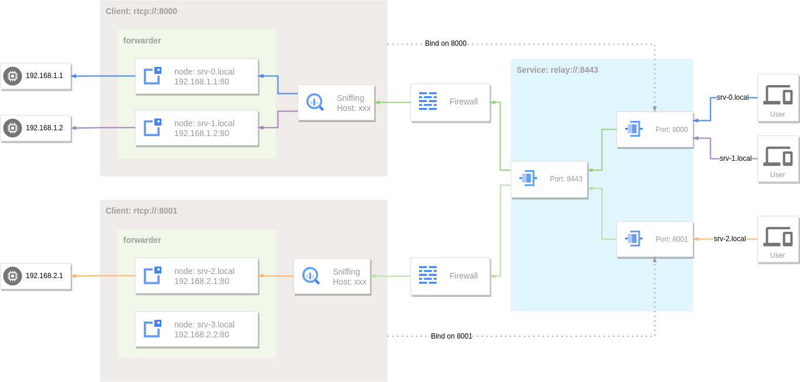

# 反向代理

[反向代理](https://zh.wikipedia.org/wiki/%E5%8F%8D%E5%90%91%E4%BB%A3%E7%90%86)是代理服务的一种。服务器根据客户端的请求，从其关系的一组或多组后端服务器（如Web服务器）上获取资源，然后再将这些资源返回给客户端，客户端只会得知反向代理的IP地址，而不知道在代理服务器后面的服务器集群的存在。

GOST中的[端口转发](port-forwarding.md)服务也可以被当作是一种功能受限的反向代理，因其只能转发到固定的一个或一组后端服务。

反向代理是端口转发服务的一个扩展，其依托于端口转发功能，并通过嗅探转发的请求数据来获取特定协议(目前支持HTTP/HTTPS)中的目标主机信息。

关于反向代理更详细的说明可以参考这篇[博文](https://gost.run/blog/2023/reverse-proxy/)。

## 本地端口转发

```yaml
services:
- name: https
  addr: :443
  handler:
    type: tcp
    metadata:
      sniffing: true
  listener:
    type: tcp
  forwarder:
    nodes:
    - name: google
      addr: www.google.com:443
      # filter:
      #   host: www.google.com
      matcher:
        rule: Host(`www.google.com`)
    - name: github
      addr: github.com:443
      # filter:
      #   host: *.github.com
      matcher:
        rule: Host(`*.github.com`)
- name: http
  addr: :80
  handler:
    type: tcp
    metadata:
      sniffing: true
  listener:
    type: tcp
  forwarder:
    nodes:
    - name: example-com
      addr: example.com:80
      # filter:
      #   host: example.com
      matcher:
        rule: Host(`example.com`)
    - name: example-org
      addr: example.org:80
      # filter:
      #   host: example.org
      #   path: /
      matcher:
        rule: Host(`example.org`) && Pathprefix(`/`)
```

通过`sniffing`选项来开启流量嗅探，并在`forwarder.nodes`中通过`matcher.rule`选项对节点设置路由规则。

当开启流量嗅探后，转发服务会对客户端的请求信息应用转发器(forwarder)中节点设置的匹配规则(matcher.rule)过滤出最终转发的目标节点。

 

此时可以将对应的域名解析到本地通过反向代理来访问：

```bash
curl --resolve www.google.com:443:127.0.0.1 https://www.google.com
```

```bash
curl --resolve example.com:80:127.0.0.1 http://example.com
```

## 远程端口转发

远程端口转发服务同样也可以对流量进行嗅探。

```yaml
services:
- name: https
  addr: :443
  handler:
    type: rtcp
    metadata:
      sniffing: true
  listener:
    type: rtcp
    chain: chain-0
  forwarder:
    nodes:
    - name: local-0
      addr: 192.168.1.1:443
      # filter:
      #   host: srv-0.local
      matcher:
        rule: Host(`srv-0.local`)
    - name: local-1
      addr: 192.168.1.2:443
      # filter:
      #   host: srv-1.local
      matcher:
        rule: Host(`srv-1.local`)
    - name: fallback
      addr: 192.168.2.1:443
- name: http
  addr: :80
  handler:
    type: rtcp
    metadata:
      sniffing: true
  listener:
    type: rtcp
    chain: chain-0
  forwarder:
    nodes:
    - name: local-0
      addr: 192.168.1.1:80
      # filter:
      #   host: srv-0.local
      matcher:
        rule: Host(`srv-0.local`)
    - name: local-1
      addr: 192.168.1.2:80
      # filter:
      #   host: srv-1.local
      matcher:
        rule: Host(`srv-1.local`)
chains:
- name: chain-0
  hops:
  - name: hop-0
    nodes:
    - name: node-0
      addr: SERVER_IP:8443 
      connector:
        type: relay
      dialer:
        type: wss
```

 

此时可以将对应的域名解析到服务器地址通过反向代理来访问内网服务：

```bash
curl --resolve srv-0.local:443:SERVER_IP https://srv-0.local
```

```bash
curl --resolve srv-1.local:80:SERVER_IP http://srv-1.local
```

如果访问的目标主机没有与转发器中的节点设定的主机名匹配上，当存在没有设置主机名的节点，则会在这些节点中选择一个使用。

```bash
curl --resolve srv-2.local:443:SERVER_IP https://srv-2.local
```

由于srv-2.local没有匹配到节点，因此会被转发到fallback节点(192.168.2.1:443)。

## 请求路由

反向代理中请求到目标节点的路由通过`matcher.rule`选项设置匹配规则，当请求满足此规则时此节点为合格结点，将参与下一步的目标节点选择。匹配规则适用于所有匹配器上下文（节点、跳跃点组、转发链组）。

!!! note "`filter`选项已废弃"
    `filter`选项（`filter.host`/`filter.protocol`/`filter.path`）已不推荐使用，在配置解析时会自动转换为等价的`matcher.rule`规则（分别对应`Host()`/`Proto()`/`PathPrefix()`），并将在未来的版本中移除。建议直接使用`matcher.rule`，它覆盖了相同的使用场景并提供了更强大的 DSL 表达式。详见 [匹配器](../concepts/matcher.md)。

### 常用匹配条件

#### 主机名过滤

通过`matcher.rule`选项中的`Host()`匹配器为节点设置主机名过滤。

`Host()`支持通配符，`Host(`.example.com`)`匹配example.com的子域名abc.example.com，def.abc.example.com等。若要同时匹配example.com本身及其子域名，使用`Host(`example.com`) || Host(`.example.com`)`。

```yaml  hl_lines="15 19"
services:
- name: http
  addr: :80
  handler:
    type: tcp
    metadata:
      sniffing: true
  listener:
    type: tcp
  forwarder:
    nodes:
    - name: example-com
      addr: example.com:80
      matcher:
        rule: Host(`example.com`)
    - name: example-org
      addr: example.org:80
      matcher:
        rule: Host(`example.org`) || Host(`.example.org`)
```

#### 应用协议过滤

通过`matcher.rule`选项中的`Proto()`匹配器设置协议类型过滤，当嗅探到对应类型流量则会转发到此节点。

目前支持的应用协议有：

* `http` - HTTP流量数据。
* `tls` - TLS流量数据。
* `ssh` - SSH流量数据。

```yaml hl_lines="15 19 23"
services:
- name: service-0
  addr: :8000
  handler:
    type: tcp
    metadata:
      sniffing: true
  listener:
    type: tcp
  forwarder:
    nodes:
    - name: http-server
      addr: example.com:80
      matcher:
        rule: Host(`example.com`) && Proto(`http`)
    - name: https-server
      addr: example.com:443
      matcher:
        rule: Host(`example.com`) && Proto(`tls`)
    - name: ssh-server
      addr: example.com:22
      matcher:
        rule: Proto(`ssh`)
```

#### URL路径过滤

通过`matcher.rule`选项中的`PathPrefix()`匹配器为节点设置路径前缀过滤。当嗅探到HTTP流量后，会使用URL路径前缀匹配模式来选择节点。

```yaml hl_lines="15 19"
services:
- name: http
  addr: :80
  handler:
    type: tcp
    metadata:
      sniffing: true
  listener:
    type: tcp
  forwarder:
    nodes:
    - name: target-0
      addr: 192.168.1.1:80
      matcher:
        rule: PathPrefix(`/`)
    - name: target-1
      addr: 192.168.1.2:80
      matcher:
        rule: PathPrefix(`/test`)
```

### 规则匹配

除了上面的常用匹配条件外，请求路由还集成了灵活的规则路由DSL，通过`matcher.rule`选项可以组合更复杂的匹配规则。

```yaml hl_lines="15 19"
services:
- name: http
  addr: :80
  handler:
    type: tcp
    metadata:
      sniffing: true
  listener:
    type: tcp
  forwarder:
    nodes:
    - name: target-0
      addr: 192.168.1.1:80
      matcher:
        rule: Host(`www.example.com`) || Host(`www.example.org`)
    - name: target-1
      addr: 192.168.1.2:80
      matcher:
        rule: Host(`*.example.com`)
```

完整的DSL参考 — 包括所有匹配器函数、比较运算符、请求体匹配细节、正则语法和请求体大小设置 — 请参见 **[匹配器](../concepts/matcher.md)**。

!!! tip "复杂规则"
    AND (`&&`)、OR (`||`) 和 NOT (`!`) 运算符可以与括号组合使用：

    ```yaml
    Host(`example.com`) || (Host(`example.org`) && !Path(`/path`))
    ```

    上面的规则匹配：主机名是`example.com`，或者主机名是`example.org`且路径不是`/path`。

#### 优先级

为了避免路径重叠，默认情况下路由按规则长度降序排序——最长的规则拥有最高优先级。通过`matcher.priority`选项可以覆盖此行为，设置为负数则禁用自动排序。详见 [匹配器 - 优先级](../concepts/matcher.md#_5)。

```yaml hl_lines="16 21"
services:
- name: http
  addr: :80
  handler:
    type: tcp
    metadata:
      sniffing: true
  listener:
    type: tcp
  forwarder:
    nodes:
    - name: target-0
      addr: 192.168.1.1:80
      matcher:
        rule: Host(`www.example.com`)
        priority: 100
    - name: target-1
      addr: 192.168.1.2:80
      matcher:
        rule: Host(`*.example.com`)
        priority: 50
```

当请求的Host为`www.example.com`时，会优先选择`target-0`节点。

## HTTP请求设置

当嗅探到HTTP流量时，可以在目标节点上通过`forwarder.nodes.http`选项对HTTP的请求信息进行设置，包括Host头重写，自定义头部信息，开启Basic Auth，URL路径重写。对本地和远程端口转发均适用。

### 重写Host头

通过设置`http.host`选项可以重写原始请求头中的Host。

```yaml hl_lines="16 17"
services:
- name: http
  addr: :80
  handler:
    type: tcp
    metadata:
      sniffing: true
  listener:
    type: tcp
  forwarder:
    nodes:
    - name: example-com
      addr: example.com:80
      # filter:
      #   host: example.com
      matcher:
        rule: Host(`example.com`)
      http:
        host: test.example.com
    - name: example-org
      addr: example.org:80
      # filter:
      #   host: example.org
      matcher:
        rule: Host(`example.org`)
      http:
        host: test.example.org:80
```

```bash
curl --resolve example.com:80:127.0.0.1 http://example.com
```

当请求http://example.com时，最终发送给example.com:80的HTTP请求头中Host为test.example.com。

### 从路径动态提取Host

当上游的Host无法在配置时静态确定、而需要根据请求信息动态推导时，可以配合设置`http.hostPattern`选项，将`http.host`作为模板进行替换。

`http.hostPattern`是一个正则表达式，作用于请求的URL路径。当它匹配成功时，`http.host`会作为模板，将其中的`$1`、`$2`等捕获组引用展开为对应的捕获内容；匹配失败时Host保持不变。例如对`*.github.io`（GitHub Pages）这类由Host头路由、而非SNI路由的无限子域，可以用一个节点服务所有站点：

```yaml hl_lines="16-18"
services:
- name: http
  addr: :80
  handler:
    type: tcp
    metadata:
      sniffing: true
  listener:
    type: tcp
  forwarder:
    nodes:
    - name: pages
      addr: github.io:443
      matcher:
        rule: PathRegexp(`^/[a-z0-9-]+\.github\.io/`)
      tls:
        secure: true
        serverName: github.io
      http:
        hostPattern: '^/([a-z0-9-]+\.github\.io)/'
        host: '$1'
        rewriteURL:
        - match: '^/[a-z0-9-]+\.github\.io/'
          replacement: '/'
```

当请求`http://pages.example.com/microsoft.github.io/`时，`hostPattern`将Host提取为`microsoft.github.io`，`rewriteURL`再剥掉路径中的host前缀，最终向上游发出`GET /`、`Host: microsoft.github.io`。

`http.hostPattern` (string)
:    作用于URL路径的正则表达式，用于从请求路径中提取Host。仅在设置了`http.host`时生效，此时`http.host`被当作替换模板。

`http.host` (string)
:    当`hostPattern`未设置时为静态Host；当`hostPattern`设置时作为模板，其中的`$1`、`$2`等捕获组引用会被展开为对应捕获内容（Go正则替换语法）。

!!! note "`hostPattern`只影响Host头"
    `hostPattern`只重写HTTP的Host头，**不会**改变节点的拨号目标或TLS SNI（这两者仍由`addr`和`tls.serverName`静态决定）。因此它适用于由Host头路由的上游（如GitHub Pages），不适用于由SNI路由的上游。

### 自定义请求头

通过设置`http.requestHeader`选项可以自定义请求头部信息，如果所设置的头部字段已存在则会被覆盖。

```yaml hl_lines="16-20"
services:
- name: http
  addr: :80
  handler:
    type: tcp
    metadata:
      sniffing: true
  listener:
    type: tcp
  forwarder:
    nodes:
    - name: example-com
      addr: example.com:80
      # filter:
      #   host: example.com
      matcher:
        rule: Host(`example.com`)
      http:
        requestHeader:
          User-Agent: gost/3.0.0
          foo: bar
          bar: 123
        # host: test.example.com
    - name: example-org
      addr: example.org:80
      # filter:
      #   host: example.org
      matcher:
        rule: Host(`example.org`)
      http:
        requestHeader:
          User-Agent: curl/7.81.0
          foo: bar
          bar: baz
        # host: test.example.org:80
```

当请求http://example.com时，最终发送给example.com:80的HTTP请求头中将会添加`User-Agent`，`Foo`和`Bar`三个字段。

### 自定义响应头

通过设置`http.responseHeader`选项可以自定义响应头部信息，如果所设置的头部字段已存在则会被覆盖。

```yaml hl_lines="17-19"
services:
- name: http
  addr: :80
  handler:
    type: tcp
    metadata:
      sniffing: true
  listener:
    type: tcp
  forwarder:
    nodes:
    - name: example-com
      addr: example.com:80
      # filter:
      #   host: example.com
      matcher:
        rule: Host(`example.com`)
      http:
        responseHeader:
          foo: bar
          bar: 123
```

当请求http://example.com时，最终来自example.com:80的HTTP响应头中将会添加`Foo`和`Bar`两个字段。

### Basic Authentication

通过设置`http.auth`选项为目标节点启用[HTTP基本认证](https://zh.wikipedia.org/zh-cn/HTTP%E5%9F%BA%E6%9C%AC%E8%AE%A4%E8%AF%81)功能。

```yaml hl_lines="16-19"
services:
- name: http
  addr: :80
  handler:
    type: tcp
    metadata:
      sniffing: true
  listener:
    type: tcp
  forwarder:
    nodes:
    - name: example-com
      addr: example.com:80
      # filter:
      #   host: example.com
      matcher:
        rule: Host(`example.com`)
      http:
        auth:
          username: user
          password: pass
```

当直接请求http://example.com时，会返回HTTP状态码401要求认证。

### URL路径重写

通过设置`http.rewriteURL`选项定义URL路径重写规则。

```yaml hl_lines="16-21"
services:
- name: http
  addr: :80
  handler:
    type: tcp
    metadata:
      sniffing: true
  listener:
    type: tcp
  forwarder:
    nodes:
    - name: example-com
      addr: example.com:80
      # filter:
      #   host: example.com
      matcher:
        rule: Host(`example.com`)
      http:
        rewriteURL:
        - match: /api/login
          replacement: /user/login
        - match: /api/(.*)
          replacement: /$1
```

`rewriteURL.match` (string)
:    指定路径匹配模式(支持正则表达式)。

`rewriteURL.replacement` (string)
:    设置路径替换内容。

`http://example.com/api/login`会被重写为`http://example.com/user/login`。

`http://example.com/api/logout`会被重写为`http://example.com/logout`。

### 重写请求体和响应体

通过设置`http.rewriteRequestBody`和`http.rewriteResponseBody`(或已废弃的`http.rewriteBody`)选项定义请求体和响应体重写规则。

```yaml hl_lines="16-24"
services:
- name: http
  addr: :80
  handler:
    type: tcp
    metadata:
      sniffing: true
  listener:
    type: tcp
  forwarder:
    nodes:
    - name: example-com
      addr: example.com:80
      matcher:
        rule: Host(`example.com`)
      http:
        rewriteResponseBody:
        - match: foo
          replacement: bar
          type: text/html
        rewriteRequestBody:
        - type: application/json
          rewriter: rewriter-0
        - match: json:model
          replacement: deepseek-v4-pro
```

`match` (string)
:    指定内容匹配模式。支持两种模式：

     - **正则表达式**（默认）：对原始 body 字节进行 `regexp.ReplaceAll` 替换。`replacement` 支持 Go 正则替换语法（`$1`、`$2` 等）。
     - **`json:` 前缀**：基于 JSON 路径的字段匹配。格式：`json:<路径>[=<值正则>]`。字段值通过 [gjson](https://github.com/tidwall/gjson) 提取后与可选的值正则匹配，命中后通过 [sjson](https://github.com/tidwall/sjson) 替换。自动检测 `application/json` 内容类型，无需设置 `type`。

    当设置了`rewriter`时此项可选。

`replacement` (string)
:    设置替换内容。正则模式下支持 Go 正则替换语法。`json:` 模式下直接设置 JSON 字段的值。当设置了`rewriter`时此项无效。

`type` (string, default=text/html)
:    设置响应的内容类型，与`Content-Type`匹配。可以是`,`分割的多个类型或`*`代表匹配所有类型。`json:` 匹配无需设置此项。

`rewriter` (string)
:    :material-tag: 3.3.0 引用[重写器](../concepts/rewriter.md)插件服务，将body修改委托给外部插件处理。当设置了此项时，`match`和`replacement`将被忽略。

### 重写请求头和响应头

通过设置`http.rewriteRequestHeader`和`http.rewriteResponseHeader`选项定义请求头和响应头重写规则。

```yaml hl_lines="16-24"
services:
- name: http
  addr: :80
  handler:
    type: tcp
    metadata:
      sniffing: true
  listener:
    type: tcp
  forwarder:
    nodes:
    - name: example-com
      addr: example.com:80
      matcher:
        rule: Host(`example.com`)
      http:
        rewriteResponseHeader:
        - name: '(?i)^location$'
          match: 'https://example\.com'
          replacement: 'https://127.0.0.1:8000'
        - name: '(?i)^set-cookie$'
          match: '(?i)domain=\.?example\.com;?\s*'
          replacement: ''          # 值空 → 删除该头
        rewriteRequestHeader:
        - name: '(?i)^(referer|origin|x-forwarded-host)$'
          match: '.*'
          replacement: ''          # 删除请求头
```

`name` (string)
:    头名匹配正则（大小写不敏感）。插件模式下作为是否调用插件的门控，`name` 为空表示始终调用。

`match` (string)
:    头值匹配正则。替换结果为空则删除该头（`replacement` 为空 + `match: '.*'` 即删除该头名的所有值）。

`replacement` (string)
:    替换内容，支持 Go 正则替换语法（`$1`、`$2` 等）。替换结果为空时该头被删除。

`rewriter` (string)
:    :material-tag: 3.3.0 可选，引用[重写器](../concepts/rewriter.md)插件服务。设置后将整个头块序列化为文本并委托给插件处理，插件返回修改后的头块文本再解析回。元数据中 `kind` 字段为 `"header"`（body 重写为 `"body"`）。设置此项时 `match`/`replacement` 被忽略。

!!! note "头重写的删除语义"
    正则模式下，每个匹配的头值独立替换，替换结果为空则该值被丢弃；若某头名的所有值均被清空，该头被删除。这是删除请求/响应头（如剥离 `Set-Cookie` 的 `Domain`、删除 `Referer`/`Origin`）的标准写法。

### 失败状态码标记

通过设置`http.failCodes`选项，当目标节点返回指定的HTTP状态码时，将该节点标记为失败节点。被标记的节点会被选择器的`FailFilter`排除，后续请求不再选择该节点，直到`failTimeout`超时后恢复。

```yaml hl_lines="11-14 21-22"
services:
- name: http
  addr: :80
  handler:
    type: tcp
    metadata:
      sniffing: true
  listener:
    type: tcp
  forwarder:
    selector:
      strategy: round
      maxFails: 1
      failTimeout: 30s
    nodes:
    - name: example-com
      addr: example.com:80
      matcher:
        rule: Host(`example.com`)
      http:
        failCodes: "429,502,5xx"
```

匹配到失败状态码时，响应仍会原样转发给客户端（不做自动重试），但连接会在本次请求结束后关闭，使下一次请求重新选择节点。

`failCodes` (string)
:    以`,`分割的HTTP状态码列表，支持两种格式：

     - **精确状态码**：如`429`、`502`、`503`。
     - **百位通配**：如`5xx`匹配500-599的所有状态码。

无效项会被忽略并记录警告日志。

!!! note "建议配合 `maxFails: 1` 使用"
    节点成功建立连接时其失败标记会被重置。若`maxFails`大于1，HTTP状态码产生的失败标记可能在达到阈值前被后续成功建立的连接清除。设置`maxFails: 1`可以让一次状态码命中立即排除该节点。

## TLS请求设置

如果转发的目标节点启用了TLS，可以通过设置`forwarder.nodes.tls`来建立TLS连接。

```yaml hl_lines="16-23"
services:
- name: http
  addr: :80
  handler:
    type: tcp
    metadata:
      sniffing: true
  listener:
    type: tcp
  forwarder:
    nodes:
    - name: example-com
      addr: example.com:443
      # filter:
      #   host: example.com
      matcher:
        rule: Host(`example.com`)
      tls:
        secure: true
        serverName: example.com
        options:
          minVersion: VersionTLS12
          maxVersion: VersionTLS13
          cipherSuites:
          - TLS_ECDHE_RSA_WITH_AES_128_GCM_SHA256
```

`tls.secure` (bool, default=false)
:    是否开启服务器证书和域名校验。

`tls.serverName` (string)
:    若`secure`设置为true，则需要通过此参数指定服务器域名用于域名校验。

`tls.options.minVersion` (string)
:    TLS最小版本，可选值`VersionTLS10`，`VersionTLS11`，`VersionTLS12`，`VersionTLS13`。

`tls.options.maxVersion` (string)
:    TLS最大版本，可选值`VersionTLS10`，`VersionTLS11`，`VersionTLS12`，`VersionTLS13`。

`tls.options.cipherSuites` (list)
:    加密套件，可选值参考[Cipher Suites](https://pkg.go.dev/crypto/tls#pkg-constants)。

## 空节点

:material-tag: 3.2.3

当节点的地址为空时此节点被称为空节点。在反向代理模式中空节点有一些特殊的行为。

```yaml
services:
- name: http
  addr: :80
  handler:
    type: tcp
    metadata:
      sniffing: true
  listener:
    type: tcp
  forwarder:
    nodes:
    - name: sni
      # addr is empty
      matcher:
        rule: Host(`example.com`)
```

如果转发器中选中的节点是一个空节点，则节点的地址会被设置为嗅探到的主机名，此时的反向代理相当于一个SNI代理，会根据请求信息动态连接到相应的目标地址。


## 转发通道

除了原始TCP数据通道可以用来作为端口转发，其他数据通道也可以作为端口转发服务。

### TLS转发通道

HTTPS-to-HTTP反向代理。

TLS转发通道可以动态的给后端HTTP服务添加TLS支持。

```yaml
services:
- name: https
  addr: :443
  handler:
    type: forward
    metadata:
      sniffing: true
  listener:
    type: tls
  forwarder:
    nodes:
    - name: example-com
      addr: example.com:80
      # filter:
      #   host: .example.com
      matcher:
        rule: Host(`.example.com`)
    - name: example-org
      addr: example.org:80
      # filter:
      #   host: .example.org
      matcher:
        rule: Host(`.example.org`)
```

```bash
curl -k --resolve example.com:443:127.0.0.1 https://example.com
```

### HTTP3转发通道

HTTP3-to-HTTP反向代理。

HTTP3转发通道可以动态的给后端HTTP服务添加HTTP/3支持。

```yaml
services:
- name: http3
  addr: :443
  handler:
    type: http3
  listener:
    type: http3
  forwarder:
    nodes:
    - name: example-com
      addr: example.com:80
      # filter:
      #   host: .example.com
      matcher:
        rule: Host(`.example.com`)
    - name: example-org
      addr: example.org:80
      # filter:
      #   host: .example.org
      matcher:
        rule: Host(`.example.org`)
```

```bash
curl -k --http3 --resolve example.com:443:127.0.0.1 https://example.com
```
