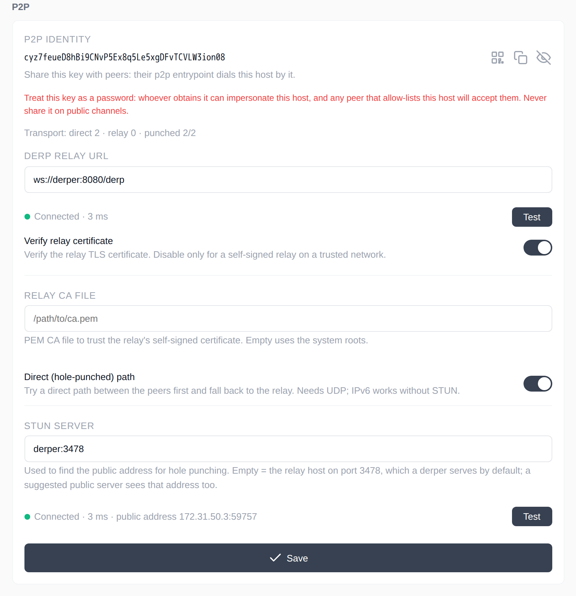
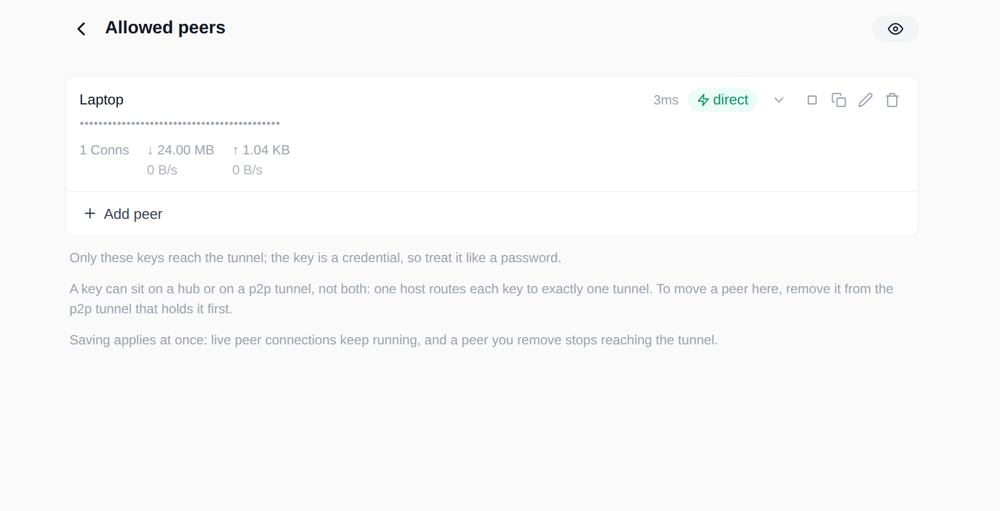
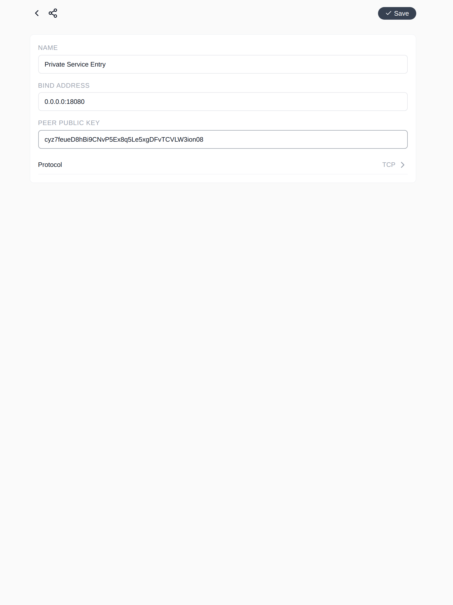
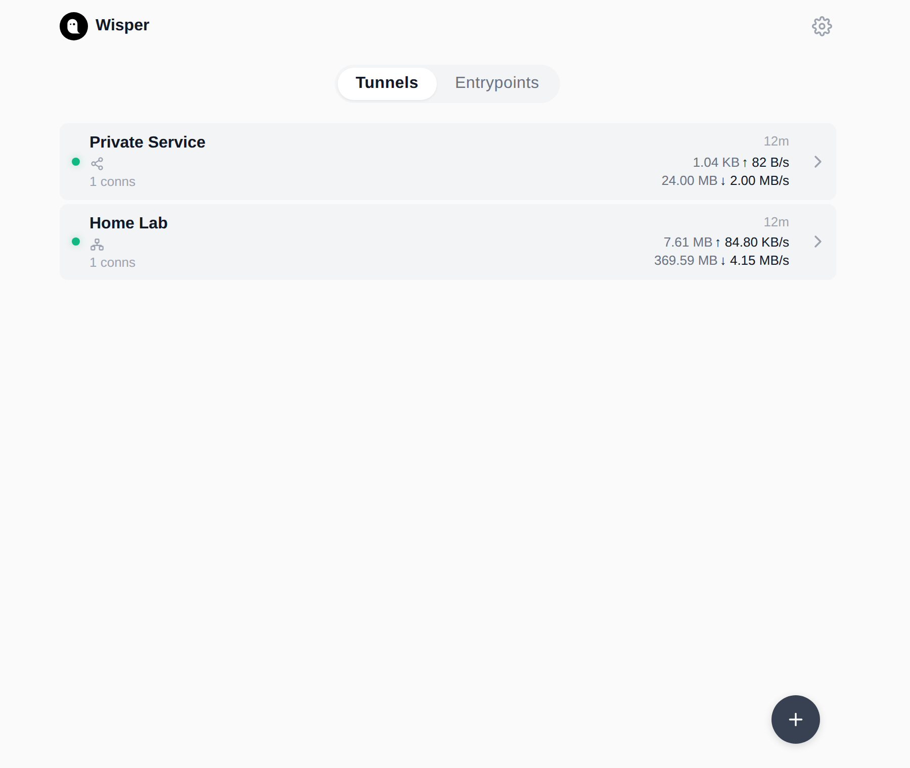
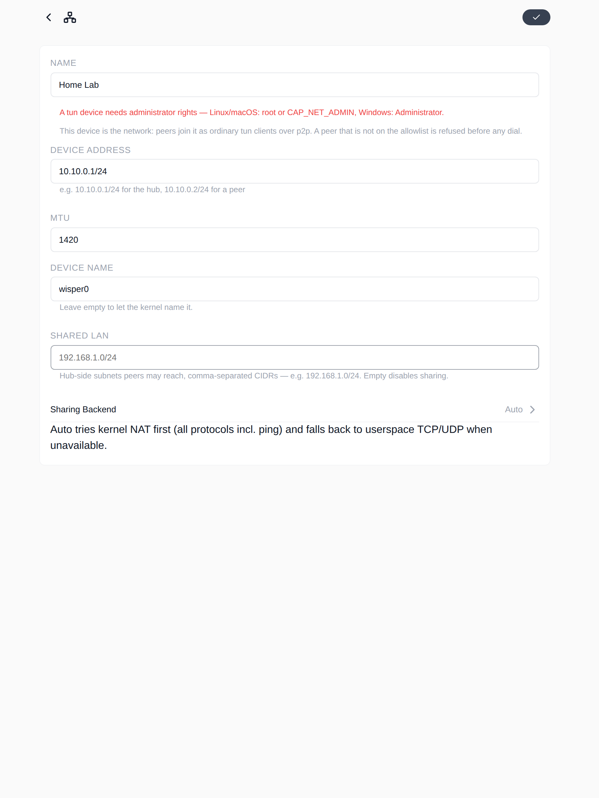
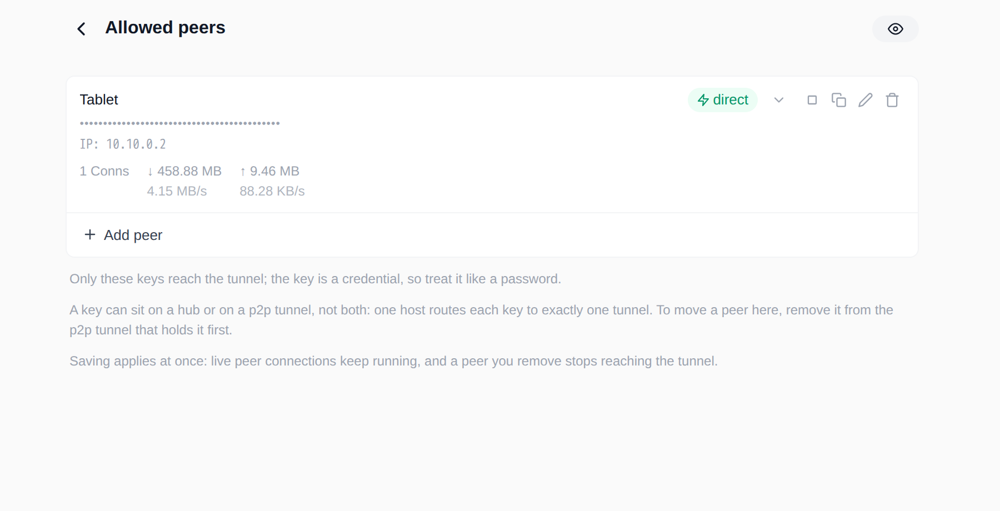
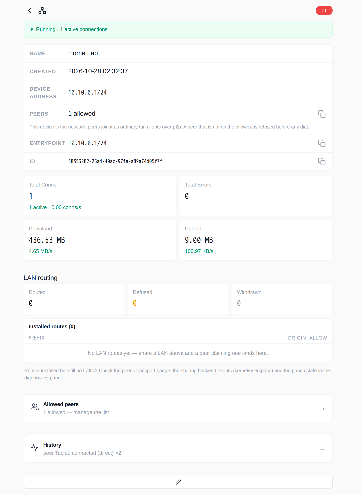

---
authors:
  - ginuerzh
categories:
  - Tutorial
readtime: 15
date: 2026-10-28
comments: true
---

# Building a Private P2P Network with wisper: Public-Key Tunnels and TUN Networking

wisper is more than a reverse-tunnel manager that exposes a local port to the public internet. It also supports two more private modes:

<!-- more -->

1. **P2P tunnel** — expose a local service to peers by public key, with no public URL and no open port;
2. **TUN networking** — let another machine join a virtual network and reach the hub (and the networks behind it) as if they were on the same LAN.

This tutorial walks through both with three roles. The screenshots come from a real wisper deployment (English UI); commands and explanations are in English.

## What you will build

- Serve a local service to a specific peer through a DERP relay, using public keys instead of a public endpoint;
- Read the `direct` / `relay` transport badge and know which path the traffic takes;
- Create a TUN hub, add a spoke to its virtual network, and verify it with `ping` and TCP;
- Understand the key, allowlist, routing, and privilege boundaries well enough to debug your own setup.

The lab topology:

| Role | Address | Purpose |
|---|---|---|
| DERP relay | `ws://derper:8080` | Signaling + fallback (self-hosted in the lab; use `wss://` in production) |
| hub | `10.10.0.1/24` | Holds the TUN device; its P2P tunnel exposes `127.0.0.1:8080` |
| laptop | `127.0.0.1:18080` | P2P entrypoint; reaches the service on the hub |
| tablet | `10.10.0.2/24` | TUN spoke; joins the hub's virtual network |

!!! note "Why two spokes in the lab"
    Both a P2P entrypoint and a TUN entrypoint use the host's p2p identity (public key). On one host, **a key can belong to only one p2p tunnel or one tun hub** — inbound streams are routed by key and cannot point at two objects. That is why the lab uses `laptop` for P2P and `tablet` for TUN. In practice, use two devices, or put the P2P tunnel on a different hub.

## Prerequisites

### Install and start

Docker is the quickest option:

```bash
docker run -d --name wisper \
  -p 127.0.0.1:8900:8900 \
  -v wisper-data:/root/.config/wisper \
  gogost/wisper:latest
```

Open `http://127.0.0.1:8900`. A TUN hub (or a TUN spoke that creates a device) needs `NET_ADMIN` and `/dev/net/tun`; to let peers reach the **host's real LAN**, it also needs host networking:

```bash
docker run -d --name wisper \
  --network=host \
  --cap-add=NET_ADMIN \
  --device /dev/net/tun:/dev/net/tun \
  -v wisper-data:/root/.config/wisper \
  gogost/wisper:latest -addr 127.0.0.1:8900

# Only needed on a Linux hub when spokes must reach each other
sudo sysctl -w net.ipv4.ip_forward=1
```

You can also download a binary for Linux, macOS, Windows, Android, or Chrome from [GitHub Releases](https://github.com/go-gost/wisper/releases):

```bash
sudo ./wisper -addr 127.0.0.1:8900
```

!!! warning "The wisper web UI/API has no login"
    `-addr` defaults to `:8900` (all interfaces). Bind it to `127.0.0.1`, or put it behind a reverse proxy with authentication and TLS. Do not expose port 8900 directly to the internet — anyone who can open the page can create tunnels.

### Prepare the DERP relay

P2P uses a DERP relay for signaling and fallback: traffic takes the hole-punched path when possible, and the relay when it cannot.

- **Public default**: `wss://derp.gost.run/derp`; leave the field empty to use it.
- **Self-hosted**: use `deploy/docker-compose.yml` from [go-gost/derper](https://github.com/go-gost/derper). It serves plain WebSocket on `:8443` and STUN on `:3478` by default; put TLS in front for `wss://` in production.

When STUN is empty, wisper derives "relay host + 3478". If the relay does not serve STUN, wisper probes it, gives up on punching, and keeps using the relay — it does not hang.

### Check the identity

On both the service side and the client side, open **Settings → P2P**:

1. Click the eye icon to reveal **P2P IDENTITY**, then copy it;
2. Enter the DERP URL and click **Test**; it should say `Connected`;
3. Keep **Direct (hole-punched) path** on. If STUN is not the default, enter it and click **Test**; it should show a public address;
4. Click **Save**.



The public key is this host's identity. Share it with peers for dialing and allowlisting. The real secret is the private key in `p2p/host.key`; never share that.

!!! note "About the red warning in the screenshot"
    The Settings page calls the identity key a password. That is conservative wording: the **public key is meant to be shared** with peers that need to dial or allowlist you. Only the private key (`p2p/host.key`) lets someone impersonate this host. The allowlist decides which identities may connect.

!!! note "About the relay URL in the screenshot"
    `ws://derper:8080/derp` is the lab's self-hosted plaintext relay. In production use `wss://`, and enable **Verify relay certificate** or provide a **Relay CA file** as needed.

## Part 1: Reach a local service by public key (P2P)

### 1. Create the P2P tunnel on the service side

On the hub, open **Tunnels → + → P2P**:


Fill in:

| Field | Example | Notes |
|---|---|---|
| Name | `Private Service` | Display only |
| Endpoint | `127.0.0.1:8080` | The local TCP/UDP service to expose |

Save, and the tunnel starts immediately. A P2P tunnel has no public URL and no listening port — only allowlisted public keys can dial in.

### 2. Allow the client's public key

Open the tunnel, go to **Allowed peers**, click **Add peer**, paste the client `laptop`'s public key, and give it the alias `Laptop`:



A few rules that are easy to miss:

- **Pending requests**: a key that knocks but is on no allowlist appears in the requests list on the peers page. A p2p stream carries no destination, so wisper cannot tell which tunnel it wanted; **Add to this tunnel** is what puts it on the current one.
- **Disabled**: the key stays on the list but new connections are refused; established connections finish naturally. Useful for a temporary block instead of a delete.
- **One key, one object per host**: on the same host, a key belongs either to one p2p tunnel or to one tun hub. To move a peer, remove it from the old object first.
- **Public key is identity**: the allowlist is the only application-level admission for p2p; there is no username/password on top. The public key is shareable; the private key is not.

### 3. Create the P2P entrypoint on the client

On `laptop`, open **Entrypoints → + → P2P**:



The screenshot binds `0.0.0.0:18080` so the host can reach it; for everyday use, bind `127.0.0.1:18080` and keep it local.

| Field | Example | Notes |
|---|---|---|
| Name | `Private Service Entry` | Display only |
| Bind Address | `127.0.0.1:18080` | Local listen address; `0.0.0.0` exposes it to the LAN |
| Peer Public Key | the hub's P2P IDENTITY | Dial target |
| Protocol | `TCP` or `UDP` | Inner protocol; choose what the local client needs |

After saving, traffic to `127.0.0.1:18080` on `laptop` goes through the p2p tunnel to `127.0.0.1:8080` on the hub.

### 4. Verify

```bash
curl -sS http://127.0.0.1:18080/healthz
```

Expected output:

```text
ok
```

The entrypoint detail page should show something like this (numbers vary with traffic):

```text
Running
Transport  direct  1ms
Total Conns  7
Download     12.00 MB
```

`direct` means the peers punched through and traffic bypasses the relay. `relay` still works, only through the relay. The home cards and the peers page show cumulative bytes, active connections, and live rates:



### 5. UDP and keepalive

Set the entrypoint's **Protocol** to `UDP` and the same p2p tunnel can serve UDP peers — the tunnel side needs no change and serves TCP and UDP transparently.

- **Keepalive on (default)**: keep the client session and its tunnel alive between datagrams; good for long-lived UDP applications.
- **Keepalive off**: one tunnel per datagram; correct semantics, higher overhead.

!!! note "TCP half-close limitation on P2P entrypoints"
    The current implementation does not support TCP half-close: after the client calls `shutdown(SHUT_WR)`, the return direction also ends. `curl` and browsers are unaffected; busybox `wget` and some `nc` usages may close the write side immediately after sending and never see the response. Use `curl` when verifying.

## Part 2: Build a virtual network with TUN

### Roles and addresses

A P2P tunnel is "reach one service by public key". TUN is "join an IP network".

| Role | Responsibility | Privilege |
|---|---|---|
| **hub** | Holds the tun device; the device *is* the network and forwards between peers | root / `CAP_NET_ADMIN` / Administrator |
| **spoke** | Creates its own tun device and joins the hub's network | root / `CAP_NET_ADMIN` / Administrator (Android uses VpnService) |

- The hub assigns addresses: with `net` `10.10.0.1/24`, the first spoke is usually `10.10.0.2/24`.
- The spoke's configured address must **exactly match** the address assigned on the hub's peers page.
- The topology is a star: traffic goes through the hub. Spoke-to-spoke traffic needs IP forwarding on the hub.

### 1. Create the hub

On the hub, open **Tunnels → + → TUN**:



| Field | Example | Notes |
|---|---|---|
| Name | `Home Lab` | Display only |
| Device Address | `10.10.0.1/24` | The hub device address; this subnet is the virtual network |
| MTU | `1420` | Default; usually no need to change |
| Device Name | `wisper0` | Leave empty to let the kernel name it |
| Shared LAN | empty | Fill in later to share the hub-side LAN with spokes |

Save. The hub creates a tun device and waits for allowlisted spokes. With no peers it reports "running, but routing nothing".

### 2. Assign the spoke address on the hub

Go to **Allowed peers → Add peer**, paste `tablet`'s public key, set the alias `Tablet`, leave **IP** empty so the hub allocates one, and save:



It shows `IP: 10.10.0.2`; copy that address into the spoke's configuration. Some details:

- The IP in the row is **the address this spoke may claim**; the spoke's declaration must match it exactly. Otherwise the hub installs no route, does not echo keepalives, and records a warning event.
- **Clearing** a row means "allocate again"; a row you did not touch keeps its address.
- Changing the hub's `net` is refused if existing addresses fall outside the new subnet. To renumber, remove the spoke on the peers page, change `net`, then add it back.
- On the same host, a public key can belong to only one hub or p2p tunnel.

### 3. Join the network from the spoke

On `tablet`, open **Entrypoints → + → TUN** and fill in:

| Field | Example | Notes |
|---|---|---|
| Name | `Join Home Lab` | Display only |
| Device Address | `10.10.0.2/24` | **Must** be the address the hub assigned |
| MTU | `1420` | Keep it consistent with the hub |
| Peer Public Key | the hub's P2P IDENTITY | Dial target |
| Routes | empty | Empty routes only the hub's virtual subnet; you can add e.g. `192.168.50.0/24` |
| DNS | empty, or a DNS address the hub provides | Optional; the hub does not force it |
| Shared LAN | empty | Fill in later to share the spoke-side LAN |

Save. The spoke creates its own tun device and dials the hub through the p2p tunnel.

!!! warning "About `0.0.0.0/0`"
    `0.0.0.0/0` sends all traffic into the tun. On desktop you must exclude the DERP and hole-punching traffic from the tun yourself (policy routing / exclude the relay address), or the connection carrying the tunnel loops back into itself. The Android build does not do full-tunnel egress yet. This tutorial routes only the virtual subnet.

### 4. Verify

On `tablet`:

```bash
ping -c 2 10.10.0.1
```

Expected output:

```text
PING 10.10.0.1 (10.10.0.1): 56 data bytes
64 bytes from 10.10.0.1: seq=0 ttl=64 time=0.500 ms
64 bytes from 10.10.0.1: seq=1 ttl=64 time=0.579 ms

--- 10.10.0.1 ping statistics ---
2 packets transmitted, 2 packets received, 0% packet loss
```

If the hub runs a service on `10.10.0.1:8080` (or `0.0.0.0:8080`), verify TCP too:

```bash
curl -sS http://10.10.0.1:8080/healthz
```

Expected output:

```text
ok
```




### 5. Share a LAN (optional)

TUN routes only the virtual subnet by default. To let a spoke reach the hub's real LAN, or the other way around, add explicit sharing:

| Scenario | Where to configure | Effect |
|---|---|---|
| A spoke reaches the hub's LAN | The hub's **Shared LAN**, e.g. `192.168.1.0/24` | Spokes can reach the LAN behind the hub |
| The hub or other peers reach a spoke's LAN | The spoke's **Shared LAN**, e.g. `192.168.50.0/24`, plus a **LAN allow** row for that spoke on the hub's peers page | The hub approves or refuses the claim; refusals are recorded as events |

Leave **Sharing Backend** on `Auto`: it prefers kernel NAT (all protocols, including `ping`) and falls back to userspace TCP/UDP. After a fallback, `ping` does not reach the shared LAN, but TCP/UDP still works.

!!! tip "Spoke-to-spoke traffic"
    Traffic between two spokes must be forwarded by the hub. A Linux hub needs `net.ipv4.ip_forward=1` and firewall forwarding rules; reaching the hub itself does not require it.

### 6. Android as a spoke

The Android app borrows a tun device from the system's `VpnService`. It does not need root, but it can only be a **spoke, not a hub**:

- The first start shows a one-time VPN permission prompt.
- The device address must still be the one the hub assigned.
- Android allows only one VPN at a time. If another VPN takes over, wisper's tun entrypoint stops instead of fighting for the device; start it again to preempt the other app.
- The current build does not do full-tunnel egress; it routes the virtual subnet (and any subnets you configure explicitly).

## Security model

- **Public key is identity, private key is the credential.** The public key (P2P IDENTITY) is used for dialing and allowlists and can be shared. The private key lives in `p2p/host.key`; leaking it is what lets someone impersonate this host. The allowlist decides which identities may connect, and the forced encrypted handshake proves possession of the matching private key.
- **The data plane is end-to-end encrypted.** The current p2p data plane forces X25519 ephemeral keys plus ChaCha20-Poly1305, for TCP and UDP, over both direct and relayed paths. The relay forwards ciphertext only; it can see connection metadata (keys, timing, byte counts) and can deny service, but it cannot read or downgrade the traffic.
- **The inner protocol is still raw TCP/UDP.** p2p protects the link between peers; it does not add TLS to your application. Keep using HTTPS or application-level authentication for HTTP services.
- **The web UI/API has no authentication.** Bind it to `127.0.0.1` or put it behind an authenticating reverse proxy.
- **Rotate the identity**: stop wisper, delete `p2p/host.key` from the config directory, start it again to generate a new key, then update every peer's allowlist.
- **A TUN hub touches the host network.** When sharing a LAN, review the allowlist and firewall rules carefully.

!!! note "UI copy"
    If the entrypoint detail page says "unencrypted (the inner protocol is plaintext)", that copy predates forced p2p encryption. Trust `encryption is forced` in the **Settings → Diagnostics** report instead.

## Troubleshooting

### Transport badges

| Badge | Meaning | What to do |
|---|---|---|
| `direct` | Hole punching succeeded; traffic bypasses the relay | Nothing |
| `relay` | Traffic goes through the relay, not the direct path | Check UDP/STUN; symmetric NAT makes this expected |
| `punching` | Direct path is being negotiated | Wait |
| `failed` | Punching failed for this peer (often symmetric NAT) | It falls back to the relay; check the network |
| `no-candidates` | No usable STUN and no IPv6 | Configure STUN |
| `stun-unreachable` | STUN is configured but not responding | Fix the STUN address/port |

Hover over the badge to see the reason. Home cards do not show a badge because one tunnel can have multiple peers on different paths; the peers page and entrypoint detail page do.

### Common issues

| Symptom | Likely cause | Fix |
|---|---|---|
| Settings → P2P **Test** fails | Wrong URL, firewall, `ws://` vs `wss://`, self-signed certificate | Check URL/port and firewall; disable certificate verification or provide a CA for a self-signed relay; use `ws://` only for trusted-LAN debugging |
| Always `relay` | Symmetric NAT, UDP blocked, STUN unreachable | This is the expected fallback; check the STUN test |
| Client connects but the service does not respond | Wrong Endpoint, service not listening, allowlist not saved | `curl` the local service on the hub first |
| Entrypoint cannot connect | Wrong public key, key already on another object, allowlist missing | Compare P2P IDENTITY and the peers page |
| TUN `ping` fails | Spoke address does not match the hub's assignment, hub not running, firewall | Compare the IP on the peers page; check hub events |
| TUN TCP works but `ping` to a shared LAN does not | Sharing Backend fell back to userspace | Install iptables / grant `NET_ADMIN` so kernel NAT can run |
| Creating a TUN device fails with a privilege error | No root/CAP_NET_ADMIN, or the container lacks `/dev/net/tun` | Add the privileges from "Prerequisites" |

### Diagnostics and events

**Settings → Diagnostics → Run diagnostic** produces a pasteable report: relay state, transport counters, each peer's path, and recent punch records. The peers page's **History** and **Settings → Host events** record disconnects, recoveries, and lifecycle events. Check these three before digging through logs.

## Automating with the API (optional)

Every UI action has an HTTP API. For example, create a P2P tunnel on the hub and add a peer:

```bash
HUB=http://127.0.0.1:8900

# Create the P2P tunnel and keep its id
TID=$(curl -s -X POST "$HUB/api/tunnels" \
  -H 'Content-Type: application/json' \
  -d '{"name":"Private Service","type":"p2p","endpoint":"127.0.0.1:8080"}' \
  | jq -r .id)

# Add the client's public key to the allowlist
curl -s -X PUT "$HUB/api/tunnels/$TID/peers" \
  -H 'Content-Type: application/json' \
  -d '{"peers":[{"key":"<laptop-key>","alias":"Laptop"}]}' \
  | jq '{name,status}'
# {"name":"Private Service","status":"running"}
```

Create the entrypoint on the client:

```bash
CLIENT=http://127.0.0.1:8900

curl -s -X POST "$CLIENT/api/entrypoints" \
  -H 'Content-Type: application/json' \
  -d '{"name":"Private Service Entry","type":"p2p","endpoint":"127.0.0.1:18080","peer":"<hub-key>","protocol":"tcp"}' \
  | jq '{name,type,status}'
# {"name":"Private Service Entry","type":"p2p","status":"running"}
```

TUN address assignment also works through the peers API: leave `ip` empty and the hub allocates from its `net`; the response's `options.peer_ips` carries the result. See the REST API table in the project README for the full route list.

## Cleanup

- Stop or delete tunnels and entrypoints in the UI; tun devices close with their object.
- Removing the container and its data volume (first `docker rm`, then `docker volume rm wisper-data`) clears config and identity.
- To change identity but keep the config: delete only `p2p/host.key`, restart, and redistribute the new public key.

P2P is about "reaching by public key"; TUN is about "networking by IP". Keeping those two ideas separate makes it much harder to mix up allowlists, routes, and addresses. Happy networking.

---

!!! note "About the screenshots"
    The screenshots come from an isolated Docker lab: a local derper relay, one hub, and two spokes (one for P2P, one for TUN). Addresses, keys, and traffic numbers are test data; replace them with your own relay domain, subnets, and keys.
