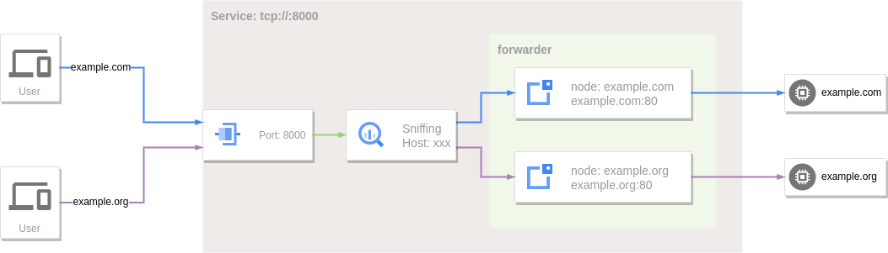

# Reverse Proxy

[Reverse Proxy](https://en.wikipedia.org/wiki/Reverse_proxy) is a type of proxy service. According to the client's request, the server obtains resources from one or more groups of backend servers (such as web servers) related to it, and then returns these resources to the client. The client only knows the IP address of the reverse proxy, without knowing the existence of server clusters behind proxy servers.

The [port forwarding](port-forwarding.md) service in GOST can also be regarded as a reverse proxy with limited functions, because it can only forward to a fixed one or a set of backend services.

Reverse proxy is an extension of the port forwarding service, which relies on the port forwarding function, and obtains the target host information in a specific protocol (currently supports HTTP/HTTPS) by sniffing the forwarded data.

## Local Port Forwarding

```yaml
services:
- name: https
  addr: :443
  handler:
    type: tcp
    metadata:
      sniffing: true
  listener:
    type: tcp
  forwarder:
    nodes:
    - name: google
      addr: www.google.com:443
      # filter:
      #   host: www.google.com
      matcher:
        rule: Host(`www.google.com`)
    - name: github
      addr: github.com:443
      # filter:
      #   host: *.github.com
      matcher:
        rule: Host(`*.github.com`)
- name: http
  addr: :80
  handler:
    type: tcp
    metadata:
      sniffing: true
  listener:
    type: tcp
  forwarder:
    nodes:
    - name: example-com
      addr: example.com:80
      # filter:
      #   host: example.com
      matcher:
        rule: Host(`example.com`)
    - name: example-org
      addr: example.org:80
      # filter:
      #   host: example.org
      #   path: /
      matcher:
        rule: Host(`example.org`) && PathPrefix(`/`)
```

Use the `sniffing` option to enable traffic sniffing, and set routing rules through the `matcher.rule` option in `forwarder.nodes`.

When traffic sniffing is enabled, the forwarding service applies the matching rules (matcher.rule) set on the forwarder's nodes to the client's request information to filter out the final forwarding target node.

 

At this time, the corresponding domain name can be resolved to the local and then accessed through the reverse proxy:

```bash
curl --resolve www.google.com:443:127.0.0.1 https://www.google.com
```

```bash
curl --resolve example.com:80:127.0.0.1 http://example.com
```

## Remote Port Forwarding

Remote port forwarding services can also sniff traffic.

```yaml
services:
- name: https
  addr: :443
  handler:
    type: rtcp
    metadata:
      sniffing: true
  listener:
    type: rtcp
    chain: chain-0
  forwarder:
    nodes:
    - name: local-0
      addr: 192.168.1.1:443
      # filter:
      #   host: srv-0.local
      matcher:
        rule: Host(`srv-0.local`)
    - name: local-1
      addr: 192.168.1.2:443
      # filter:
      #   host: srv-1.local
      matcher:
        rule: Host(`srv-1.local`)
    - name: fallback
      addr: 192.168.2.1:443
- name: http
  addr: :80
  handler:
    type: rtcp
    metadata:
      sniffing: true
  listener:
    type: rtcp
    chain: chain-0
  forwarder:
    nodes:
    - name: local-0
      addr: 192.168.1.1:80
      # filter:
      #   host: srv-0.local
      matcher:
        rule: Host(`srv-0.local`)
    - name: local-1
      addr: 192.168.1.2:80
      # filter:
      #   host: srv-1.local
      matcher:
        rule: Host(`srv-1.local`)
chains:
- name: chain-0
  hops:
  - name: hop-0
    nodes:
    - name: node-0
      addr: SERVER_IP:8443 
      connector:
        type: relay
      dialer:
        type: wss
```

 

At this time, the corresponding domain name can be resolved to the server address to access the internal service through the reverse proxy:

```bash
curl --resolve srv-0.local:443:SERVER_IP https://srv-0.local
```

```bash
curl --resolve srv-1.local:80:SERVER_IP http://srv-1.local
```

If the accessed target host does not match the hostname set by the node in the forwarder, when there are nodes without a hostname set, one of these nodes will be selected for use.

```bash
curl --resolve srv-2.local:443:SERVER_IP https://srv-2.local
```

Since srv-2.local does not match the node, it will be forwarded to the fallback node (192.168.2.1:443).

## Request Routing

Request routing to target nodes is configured through the `matcher.rule` option on each node. When a request meets the rule, the node is a qualified node and participates in the next step of target node selection. The rule works across all matcher contexts (node, hop group, chain group).

!!! note "`filter` option deprecated"
    The `filter` option (`filter.host`/`filter.protocol`/`filter.path`) is deprecated; at config parse time it is automatically converted into an equivalent `matcher.rule` (`Host()`/`Proto()`/`PathPrefix()` respectively) and will be removed in a future release. Prefer `matcher.rule` directly — it covers the same use cases with a more expressive DSL. See [Matcher](../concepts/matcher.md).

### Common Match Conditions

#### Hostname Filtering

Set hostname filtering for a node via the `Host()` matcher in `matcher.rule`.

`Host()` also supports wildcards: `Host(`.example.com`)` matches the subdomains of example.com — abc.example.com, def.abc.example.com, etc. To match example.com itself along with its subdomains, use `Host(`example.com`) || Host(`.example.com`)`.

```yaml  hl_lines="15 19"
services:
- name: http
  addr: :80
  handler:
    type: tcp
    metadata:
      sniffing: true
  listener:
    type: tcp
  forwarder:
    nodes:
    - name: example-com
      addr: example.com:80
      matcher:
        rule: Host(`example.com`)
    - name: example-org
      addr: example.org:80
      matcher:
        rule: Host(`example.org`) || Host(`.example.org`)
```

#### Protocol Filtering

The protocol type filter is set through the `Proto()` matcher in `matcher.rule`. When the corresponding type of traffic is sniffed, it will be forwarded to this node.

Currently supported application protocols are:

* `http` - HTTP traffic.
* `tls` - TLS traffic.
* `ssh` - SSH traffic.

```yaml hl_lines="15 19 23"
services:
- name: service-0
  addr: :8000
  handler:
    type: tcp
    metadata:
      sniffing: true
  listener:
    type: tcp
  forwarder:
    nodes:
    - name: http-server
      addr: example.com:80
      matcher:
        rule: Host(`example.com`) && Proto(`http`)
    - name: https-server
      addr: example.com:443
      matcher:
        rule: Host(`example.com`) && Proto(`tls`)
    - name: ssh-server
      addr: example.com:22
      matcher:
        rule: Proto(`ssh`)
```

#### URL Path Filtering

Set the path prefix filtering for the node through the `PathPrefix()` matcher in `matcher.rule`. When sniffing HTTP traffic, the URL path prefix matching pattern is used to select the node.

```yaml hl_lines="15 19"
services:
- name: http
  addr: :80
  handler:
    type: tcp
    metadata:
      sniffing: true
  listener:
    type: tcp
  forwarder:
    nodes:
    - name: target-0
      addr: 192.168.1.1:80
      matcher:
        rule: PathPrefix(`/`)
    - name: target-1
      addr: 192.168.1.2:80
      matcher:
        rule: PathPrefix(`/test`)
```

### Rule Matching

Beyond the common match conditions above, request routing also integrates a flexible
rule-based routing DSL, letting you combine more complex matching rules through the
`matcher.rule` option on each node.

```yaml hl_lines="15 19"
services:
- name: http
  addr: :80
  handler:
    type: tcp
    metadata:
      sniffing: true
  listener:
    type: tcp
  forwarder:
    nodes:
    - name: target-0
      addr: 192.168.1.1:80
      matcher:
        rule: Host(`www.example.com`) || Host(`www.example.org`)
    - name: target-1
      addr: 192.168.1.2:80
      matcher:
        rule: Host(`*.example.com`)
```

For the complete DSL reference — all matcher functions, comparison operators, body
matching details, regexp syntax, and body size settings — see **[Matcher](../concepts/matcher.md)**.

!!! tip "Complex Rules"
    AND (`&&`), OR (`||`), and NOT (`!`) operators can be combined with parentheses:

    ```yaml
    Host(`example.com`) || (Host(`example.org`) && !Path(`/path`))
    ```

#### Priority

To avoid path overlap, nodes are sorted by default in descending order using rule
length — the longest rule has the highest priority. Set `matcher.priority` to override
this. A negative value disables automatic priority ordering. See
[Matcher - Priority](../concepts/matcher.md#priority) for details.

```yaml hl_lines="16 21"
services:
- name: http
  addr: :80
  handler:
    type: tcp
    metadata:
      sniffing: true
  listener:
    type: tcp
  forwarder:
    nodes:
    - name: target-0
      addr: 192.168.1.1:80
      matcher:
        rule: Host(`www.example.com`)
        priority: 100
    - name: target-1
      addr: 192.168.1.2:80
      matcher:
        rule: Host(`*.example.com`)
        priority: 50
```

When the requested Host is `www.example.com`, the `target-0` node will be selected first.

## HTTP Request Settings

When sniffing HTTP traffic, you can set the HTTP request information on the target node through the `forwarder.nodes.http` option, including Host header rewriting, custom header information, basic auth, URL path rewriting.

### Rewrite Host Header

The Host in the original request header can be overridden by setting the `http.host` option.

```yaml hl_lines="16 17"
services:
- name: http
  addr: :80
  handler:
    type: tcp
    metadata:
      sniffing: true
  listener:
    type: tcp
  forwarder:
    nodes:
    - name: example-com
      addr: example.com:80
      # filter:
      #   host: example.com
      matcher:
        rule: Host(`example.com`)
      http:
        host: test.example.com
    - name: example-org
      addr: example.org:80
      # filter:
      #   host: example.org
      matcher:
        rule: Host(`example.org`)
      http:
        host: test.example.org:80
```

```bash
curl --resolve example.com:80:127.0.0.1 http://example.com
```

When requesting http://example.com, the Host in the HTTP request header sent to example.com:80 is test.example.com.

### Extract Host from Path

When the upstream Host cannot be determined statically at config time but must be derived from the request, set `http.hostPattern` and use `http.host` as a replacement template.

`http.hostPattern` is a regex matched against the request URL path. On a match, `http.host` is treated as a template whose `$1`, `$2`, ... capture-group references are expanded to the corresponding captures; on no match, the Host is left unchanged. This serves Host-routed (not SNI-routed) infinite subdomains such as `*.github.io` (GitHub Pages) with a single node:

```yaml hl_lines="16-18"
services:
- name: http
  addr: :80
  handler:
    type: tcp
    metadata:
      sniffing: true
  listener:
    type: tcp
  forwarder:
    nodes:
    - name: pages
      addr: github.io:443
      matcher:
        rule: PathRegexp(`^/[a-z0-9-]+\.github\.io/`)
      tls:
        secure: true
        serverName: github.io
      http:
        hostPattern: '^/([a-z0-9-]+\.github\.io)/'
        host: '$1'
        rewriteURL:
        - match: '^/[a-z0-9-]+\.github\.io/'
          replacement: '/'
```

When requesting `http://pages.example.com/microsoft.github.io/`, `hostPattern` extracts the Host as `microsoft.github.io`, `rewriteURL` then strips the host prefix from the path, and the upstream receives `GET /` with `Host: microsoft.github.io`.

`http.hostPattern` (string)
:    A regex matched against the URL path, used to derive the Host from the request path. Only takes effect when `http.host` is set, in which case `http.host` is treated as a replacement template.

`http.host` (string)
:    A static Host when `hostPattern` is unset; when `hostPattern` is set, a template whose `$1`, `$2`, ... capture-group references are expanded to the corresponding captures (Go regex replacement syntax).

!!! note "`hostPattern` only affects the Host header"
    `hostPattern` only rewrites the HTTP Host header; it does **not** change the node's dial target or TLS SNI (both remain statically determined by `addr` and `tls.serverName`). It therefore suits Host-routed upstreams (e.g. GitHub Pages), not SNI-routed ones.

### Custom Request Header

The request header can be customized by setting the `http.requestHeader` option, if the header field already exists, it will be overwritten.

```yaml hl_lines="16-20"
services:
- name: http
  addr: :80
  handler:
    type: tcp
    metadata:
      sniffing: true
  listener:
    type: tcp
  forwarder:
    nodes:
    - name: example-com
      addr: example.com:80
      # filter:
      #   host: example.com
      matcher:
        rule: Host(`example.com`)
      http:
        requestHeader:
          User-Agent: gost/3.0.0
          foo: bar
          bar: 123
        # host: test.example.com
    - name: example-org
      addr: example.org:80
      # filter:
      #   host: example.org
      matcher:
        rule: Host(`example.org`)
      http:
        requestHeader:
          User-Agent: curl/7.81.0
          foo: bar
          bar: baz
        # host: test.example.org:80
```

When requesting http://example.com, three fields `User-Agent`, `Foo` and `Bar` will be added to the HTTP request header sent to example.com:80.

### Custom Response Header

The response header can be customized by setting the `http.responseHeader` option, if the header field already exists, it will be overwritten.

```yaml hl_lines="17-19"
services:
- name: http
  addr: :80
  handler:
    type: tcp
    metadata:
      sniffing: true
  listener:
    type: tcp
  forwarder:
    nodes:
    - name: example-com
      addr: example.com:80
      # filter:
      #   host: example.com
      matcher:
        rule: Host(`example.com`)
      http:
        responseHeader:
          foo: bar
          bar: 123
```

When requesting http://example.com, `Foo` and `Bar` fields will be added to the HTTP response header received from example.com:80.

### HTTP Basic Authentication

You can enable [HTTP Basic Authentication](https://en.wikipedia.org/wiki/Basic_access_authentication) for target node by setting the `http.auth` option.

```yaml hl_lines="16-19"
services:
- name: http
  addr: :80
  handler:
    type: tcp
    metadata:
      sniffing: true
  listener:
    type: tcp
  forwarder:
    nodes:
    - name: example-com
      addr: example.com:80
      # filter:
      #   host: example.com
      matcher:
        rule: Host(`example.com`)
      http:
        auth:
          username: user
          password: pass
```

When requesting http://example.com directly, HTTP status code 401 will be returned to require authentication.

### Rewrite URL Path

Define URL path rewriting rules by setting the `http.rewriteURL` option. 

```yaml hl_lines="16-21"
services:
- name: http
  addr: :80
  handler:
    type: tcp
    metadata:
      sniffing: true
  listener:
    type: tcp
  forwarder:
    nodes:
    - name: example-com
      addr: example.com:80
      # filter:
      #   host: example.com
      matcher:
        rule: Host(`example.com`)
      http:
        rewriteURL:
        - match: /api/login
          replacement: /user/login
        - match: /api/(.*)
          replacement: /$1
```

`rewriteURL.match` (string)
:    specify path matching pattern (supports regular expression).

`rewriteURL.replacement` (string)
:    set the path replacement content.

`http://example.com/api/login` will be rewritten to `http://example.com/user/login`.

`http://example.com/api/logout` will be rewritten to `http://example.com/logout`.

### Rewrite Request/Response Body

Define the request and response body rewriting rules by setting `http.rewriteRequestBody` and `http.rewriteResponseBody` (or the deprecated `http.rewriteBody`) options.

```yaml hl_lines="16-24"
services:
- name: http
  addr: :80
  handler:
    type: tcp
    metadata:
      sniffing: true
  listener:
    type: tcp
  forwarder:
    nodes:
    - name: example-com
      addr: example.com:80
      matcher:
        rule: Host(`example.com`)
      http:
        rewriteResponseBody:
        - match: foo
          replacement: bar
          type: text/html
        rewriteRequestBody:
        - type: application/json
          rewriter: rewriter-0
        - match: json:model
          replacement: deepseek-v4-pro
```

`match` (string)
:    Specify content matching pattern. Supports two modes:

     - **Regex** (default): applied to raw body bytes via `regexp.ReplaceAll`. The `replacement` value supports Go regex replacement syntax (`$1`, `$2`, etc.).
     - **`json:` prefix**: JSON path-based field matching. Format: `json:<path>[=<value-regex>]`. The field value is extracted with [gjson](https://github.com/tidwall/gjson) and matched against the optional value regex. When matched, the field is replaced via [sjson](https://github.com/tidwall/sjson). Auto-detects `application/json` content type, no `type` field needed.

    Optional when `rewriter` is set.

`replacement` (string)
:    Set the replacement content. For regex mode, supports Go regex replacement syntax. For `json:` mode, sets the JSON field value directly. Ignored when `rewriter` is set.

`type` (string, default=text/html)
:    Set the content type matching the `Content-Type` header. Can be multiple types separated by `,` or `*` to match all types. Not needed for `json:` matches.

`rewriter` (string)
:    :material-tag: 3.3.0 Reference a [Rewriter](../concepts/rewriter.md) plugin to delegate body modification to an external service. When set, `match` and `replacement` are ignored.

### Rewrite Request/Response Header

Define the request and response header rewriting rules by setting `http.rewriteRequestHeader` and `http.rewriteResponseHeader` options.

```yaml hl_lines="16-24"
services:
- name: http
  addr: :80
  handler:
    type: tcp
    metadata:
      sniffing: true
  listener:
    type: tcp
  forwarder:
    nodes:
    - name: example-com
      addr: example.com:80
      matcher:
        rule: Host(`example.com`)
      http:
        rewriteResponseHeader:
        - name: '(?i)^location$'
          match: 'https://example\.com'
          replacement: 'https://127.0.0.1:8000'
        - name: '(?i)^set-cookie$'
          match: '(?i)domain=\.?example\.com;?\s*'
          replacement: ''          # empty value → delete the header
        rewriteRequestHeader:
        - name: '(?i)^(referer|origin|x-forwarded-host)$'
          match: '.*'
          replacement: ''          # delete request headers
```

`name` (string)
:    Header-name matching regex (case-insensitive). In plugin mode it gates whether the plugin is invoked; an empty `name` means always invoke.

`match` (string)
:    Header-value matching regex. An empty replacement result deletes the header (an empty `replacement` with `match: '.*'` removes every value of that header name).

`replacement` (string)
:    Replacement content, supporting Go regex replacement syntax (`$1`, `$2`, etc.). When the replacement result is empty, the header is deleted.

`rewriter` (string)
:    :material-tag: 3.3.0 Optional. Reference a [Rewriter](../concepts/rewriter.md) plugin. When set, the whole header block is serialized to text and delegated to the plugin, then the returned block is parsed back. The metadata `kind` field is `"header"` (body rewriting uses `"body"`). When set, `match`/`replacement` are ignored.

!!! note "Header deletion semantics"
    In regex mode, each matched header value is replaced independently; a value whose replacement is empty is dropped, and when all values of a header name become empty the header is deleted. This is the standard way to remove request/response headers (e.g. strip `Domain` from `Set-Cookie`, delete `Referer`/`Origin`).

### Failure Status Code Marking

By setting the `http.failCodes` option, a target node is marked as failed when it returns one of the specified HTTP status codes. The marked node is excluded by the selector's `FailFilter`, so subsequent requests will no longer pick it until `failTimeout` expires.

```yaml hl_lines="11-14 21-22"
services:
- name: http
  addr: :80
  handler:
    type: tcp
    metadata:
      sniffing: true
  listener:
    type: tcp
  forwarder:
    selector:
      strategy: round
      maxFails: 1
      failTimeout: 30s
    nodes:
    - name: example-com
      addr: example.com:80
      matcher:
        rule: Host(`example.com`)
      http:
        failCodes: "429,502,5xx"
```

When a failing status code matches, the response is still relayed to the client as-is (no automatic retry), but the connection is closed after this request so that the next request re-selects a node.

`failCodes` (string)
:    A `,`-separated list of HTTP status codes, supporting two formats:

     - **Exact status code**: e.g. `429`, `502`, `503`.
     - **Hundred-level wildcard**: e.g. `5xx` matches all status codes from 500 to 599.

Invalid entries are ignored with a warning log.

!!! note "Use together with `maxFails: 1`"
    A node's failure marker is reset whenever it establishes a connection successfully. If `maxFails` is greater than 1, failure marks produced by HTTP status codes may be cleared by subsequent successful connections before reaching the threshold. Setting `maxFails: 1` lets a single status-code hit exclude the node immediately.

## TLS Settings

If the forwarding target node has TLS enabled, you can establish a TLS connection by setting `forwarder.nodes.tls`.

```yaml hl_lines="16-23"
services:
- name: http
  addr: :80
  handler:
    type: tcp
    metadata:
      sniffing: true
  listener:
    type: tcp
  forwarder:
    nodes:
    - name: example-com
      addr: example.com:443
      # filter:
      #   host: example.com
      matcher:
        rule: Host(`example.com`)
      tls:
        secure: true
        serverName: example.com
        options:
          minVersion: VersionTLS12
          maxVersion: VersionTLS13
          cipherSuites:
          - TLS_ECDHE_RSA_WITH_AES_128_GCM_SHA256
```

`tls.secure` (bool, default=false)
:    Whether to enable server certificate and domain name verification.

`tls.serverName` (string)
:    If `secure` is set to true, you need to specify the server domain name for domain name verification through this parameter.

`tls.options.minVersion` (string)
:    Minimum TLS Version, `VersionTLS10`, `VersionTLS11`, `VersionTLS12` or `VersionTLS13`.

`tls.options.maxVersion` (string)
:    Maximum TLS Version, `VersionTLS10`, `VersionTLS11`, `VersionTLS12` or `VersionTLS13`.

`tls.options.cipherSuites` (list)
:    Cipher Suites, See [Cipher Suites](https://pkg.go.dev/crypto/tls#pkg-constants) for more information.

## Empty Node

:material-tag: 3.2.3

When the address of a node is empty, this node is called an empty node. In the reverse proxy mode, empty node has some special behaviors.

```yaml
services:
- name: http
  addr: :80
  handler:
    type: tcp
    metadata:
      sniffing: true
  listener:
    type: tcp
  forwarder:
    nodes:
    - name: sni
      # addr is empty
      matcher:
        rule: Host(`example.com`)
```

If the selected node in the forwarder is an empty node, the address of the node will be set to the sniffed hostname. At this time, the reverse proxy is equivalent to an SNI proxy and will dynamically connect to the corresponding target address based on the request information.


## Forwarding Tunnel

In addition to the original TCP data tunnel can be used as port forwarding, other tunnels can also be used as port forwarding services.

### TLS

HTTPS-to-HTTP

The TLS forwarding tunnel can dynamically add TLS support to the backend HTTP service.

```yaml
services:
- name: https
  addr: :443
  handler:
    type: forward
    metadata:
      sniffing: true
  listener:
    type: tls
  forwarder:
    nodes:
    - name: example-com
      addr: example.com:80
      # filter:
      #   host: .example.com
      matcher:
        rule: Host(`.example.com`)
    - name: example-org
      addr: example.org:80
      # filter:
      #   host: .example.org
      matcher:
        rule: Host(`.example.org`)
```

```bash
curl -k --resolve example.com:443:127.0.0.1 https://example.com
```

### HTTP3

HTTP3-to-HTTP.

The HTTP3 forwarding tunnel can dynamically add HTTP/3 support to the backend HTTP service.

```yaml
services:
- name: http3
  addr: :443
  handler:
    type: http3
  listener:
    type: http3
  forwarder:
    nodes:
    - name: example-com
      addr: example.com:80
      # filter:
      #   host: .example.com
      matcher:
        rule: Host(`.example.com`)
    - name: example-org
      addr: example.org:80
      # filter:
      #   host: .example.org
      matcher:
        rule: Host(`.example.org`)
```

```bash
curl -k --http3 --resolve example.com:443:127.0.0.1 https://example.com
```